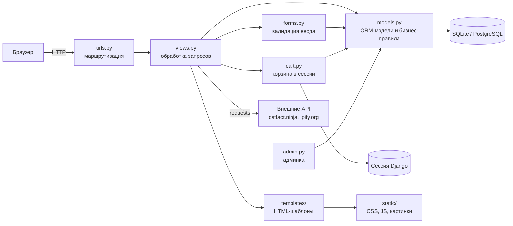

# AutoParts — интернет-магазин автозапчастей

## Назначение и пользователи

**AutoParts** — веб-приложение для продажи автомобильных запчастей: каталог с поиском и фильтрами,
корзина, оформление и оплата заказа, личный кабинет, отзывы, промокоды, статистика продаж.

Целевые пользователи:

| Роль | Кто это | Что делает |
| --- | --- | --- |
| Гость | любой посетитель | смотрит каталог, новости, информацию о компании, кладет товары в корзину, регистрируется |
| Клиент | зарегистрированный покупатель | оформляет и оплачивает заказы, отменяет неоплаченные, пишет отзывы, видит промокоды |
| Сотрудник (staff) | менеджер магазина | добавляет/редактирует/удаляет товары, смотрит статистику, меняет интервал слайдера |
| Администратор | суперпользователь | управляет всеми данными через `/admin/` |

## Стек технологий

- Язык: **Python 3.12+**
- Фреймворк: **Django 6.0**
- СУБД: **SQLite** (локально) или **PostgreSQL 16** (Docker)
- Библиотеки: `requests` (внешние API), `matplotlib` (график продаж), `Pillow`
- Фронтенд: шаблоны Django, HTML/CSS, чистый JavaScript, Chart.js
- Тесты: `pytest`, `pytest-django`, `pytest-cov`, `responses`, `unittest.mock`

## Архитектура

Классическая схема Django MVT (Model — View — Template):



## Модули

| Модуль | Ответственность |
| --- | --- |
| `config/settings.py`, `config/urls.py` | настройки проекта, выбор БД, корневые маршруты |
| `shop/models.py` | модели предметной области: товар, тип, производитель, поставщик, клиент, сотрудник, продажа, заказ, позиция заказа, промокод, отзыв, новости и т.д.; валидаторы; переходы состояний заказа (`Order.pay()`, `Order.cancel()`) |
| `shop/views.py` | обработчики страниц: каталог, корзина, оформление/оплата/отмена заказа, профиль, регистрация, отзывы, статистика, JSON-API, внешние API |
| `shop/forms.py` | формы и проверка ввода: регистрация, профиль клиента, оформление заказа, покупка, отзыв, обратная связь, товар |
| `shop/cart.py` | класс `Cart` — корзина в сессии: добавить, изменить количество, удалить, очистить, итог |
| `shop/urls.py` | маршруты приложения |
| `shop/admin.py` | настройка админ-панели |
| `shop/context_processors.py` | общие данные для всех страниц (количество в корзине, профиль компании, время) |
| `shop/timeinfo.py` | время, часовой пояс и календарь для подвала сайта |
| `shop/management/commands/seed_data.py` | заполнение БД демонстрационными данными |
| `shop/templates/`, `shop/static/` | HTML-шаблоны, стили, скрипты, изображения |
| `shop/tests/` | автотесты (юнит, интеграционные, сценарные, регрессионные) |

## Точки интеграции

| Точка | Где используется |
| --- | --- |
| **БД** (SQLite `db.sqlite3` или PostgreSQL через переменные `POSTGRES_*`) | все модели через Django ORM |
| **Сессии Django** (хранятся в БД) | корзина (`shop/cart.py`), авторизация |
| **Внешние HTTP-сервисы** | `https://catfact.ninja/fact` и `https://api.ipify.org` — страница `/external-apis/` (`views._safe_api_get`, таймаут 2 с, при ошибке — запасное значение) |
| **CDN** | шрифты Google Fonts, Chart.js (на клиенте) |
| **Файловая система** | статические файлы `shop/static/`, `staticfiles/` после `collectstatic`, файл, загружаемый в форме обратной связи (не сохраняется) |
| **JSON-API** | `/api/parts/` (каталог, нужен вход), `/api/employees/` (сотрудники) |

## Сборка и запуск

Локально (SQLite):

```bash
python3 -m venv .venv
```

```bash
.venv/bin/python -m pip install -r requirements.txt
```

```bash
.venv/bin/python manage.py migrate
```

```bash
.venv/bin/python manage.py seed_data
```

```bash
.venv/bin/python manage.py runserver
```

Сайт: http://127.0.0.1:8000/, админка: http://127.0.0.1:8000/admin/.

Через Docker (PostgreSQL):

```bash
docker compose up --build
```

Демонстрационные пользователи: `admin / admin12345` (суперпользователь), `manager / manager12345` (сотрудник),
`client1 / client12345` (клиент, есть также client2…client10).

## Тесты и покрытие

```bash
.venv/bin/python -m pytest
```

```bash
.venv/bin/python -m pytest --cov --cov-report=term-missing --cov-report=html
```

Отчет в HTML — `htmlcov/index.html`. Из покрытия исключены миграции, настройки (`config/`), `manage.py`,
скрипт демо-данных и сами тесты (`.coveragerc`).

## Документация

- [docs/requirements.md](docs/requirements.md) — спецификация требований и их верификация (ЛР1);
- [docs/state-diagram.md](docs/state-diagram.md) — диаграмма состояний заказа (ЛР1);
- [ISSUES.md](ISSUES.md) — найденные дефекты;
- [docs/testing.md](docs/testing.md) — описание тестов и покрытие (ЛР2);
- [ЗАЩИТА.md](ЗАЩИТА.md) — что показывать на защите и ответы на вопросы.

## Страницы

| Адрес | Страница |
| --- | --- |
| `/` | Главная: слайдер баннеров, витрина, последняя новость, партнеры |
| `/parts/` | Каталог: поиск, фильтр по типу, сортировка |
| `/parts/<id>/` | Карточка товара |
| `/parts/create/`, `/parts/<id>/edit/`, `/parts/<id>/delete/` | Управление товарами (сотрудник) |
| `/cart/` | Корзина |
| `/checkout/` | Оформление заказа |
| `/checkout/success/<id>/` | Подтверждение оплаченного заказа |
| `/orders/<id>/pay/`, `/orders/<id>/cancel/` | Оплата / отмена заказа, ожидающего оплаты (POST) |
| `/profile/` | Личный кабинет: заказы и история покупок |
| `/register/`, `/login/`, `/logout/` | Регистрация и вход |
| `/reviews/`, `/reviews/add/` | Отзывы |
| `/promos/` | Промокоды (нужен вход) |
| `/stats/` | Статистика продаж (сотрудник) |
| `/news/`, `/about/`, `/terms/`, `/contacts/`, `/vacancies/`, `/privacy/` | Информационные страницы |
| `/external-apis/` | Данные внешних API |
| `/api/parts/`, `/api/employees/` | JSON-API |
