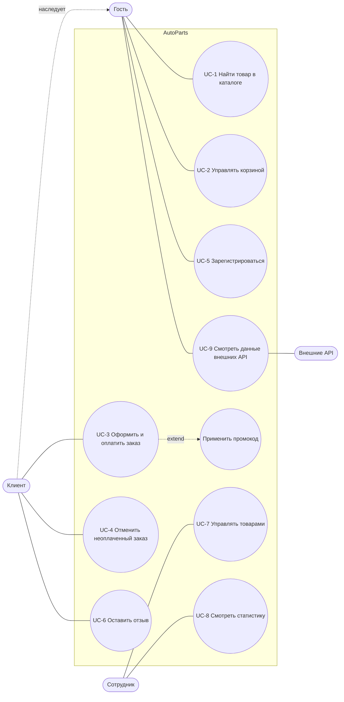

# Спецификация требований AutoParts

## 1. Бизнес-требования

**Назначение.** AutoParts — интернет-магазин автозапчастей небольшой компании.

**Проблема.** Клиенты узнают о наличии и цене деталей по телефону, менеджеры тратят время на ответы,
заказы и продажи учитываются вручную, нет статистики.

**Цели:**

- БТ-1. Клиент сам находит деталь, видит цену и наличие и оформляет заказ без звонка менеджеру.
- БТ-2. Каждая продажа автоматически списывает товар со склада — остатки всегда актуальны.
- БТ-3. Сотрудники ведут каталог и видят статистику продаж в одном месте.
- БТ-4. Промокоды позволяют проводить акции на отдельные типы товаров.

## 2. Пользовательские требования (use case)

Акторы: **Гость**, **Клиент** (наследует возможности гостя), **Сотрудник**, внешняя система **Внешние API**.

| ID | Актор | Пользовательское требование | Основной сценарий |
| --- | --- | --- | --- |
| UC-1 | Гость | Найти нужную деталь в каталоге | открыть `/parts/` → ввести запрос / выбрать тип / сортировку → открыть карточку товара |
| UC-2 | Гость, Клиент | Собрать корзину | «В корзину» на карточке → в `/cart/` изменить количество, удалить позицию или очистить корзину |
| UC-3 | Клиент | Оформить и оплатить заказ | из корзины → `/checkout/` → заполнить получателя, доставку, оплату, (промокод) → картой: заказ сразу оплачен; ЕРИП/счет: заказ ждет оплаты, клиент оплачивает в профиле |
| UC-4 | Клиент | Отменить заказ, который еще не оплачен | `/profile/` → «Отменить» у заказа со статусом «Ожидает оплаты» |
| UC-5 | Гость | Зарегистрироваться, чтобы покупать | `/register/` → заполнить форму → создается аккаунт и профиль клиента |
| UC-6 | Клиент | Оставить отзыв о магазине | `/reviews/add/` → оценка и текст → отзыв появляется на `/reviews/` |
| UC-7 | Сотрудник | Вести каталог | создать / изменить / удалить товар |
| UC-8 | Сотрудник | Анализировать продажи | `/stats/` → сумма, среднее, медиана, мода, популярный тип, график |

## 3. Функциональные требования

| ID | Требование | Связь |
| --- | --- | --- |
| FR-01 | Каталог `/parts/` показывает только активные товары (`is_active = True`). | UC-1 |
| FR-02 | Поиск по подстроке в названии, типе и производителе без учета регистра; сотрудник дополнительно ищет по артикулу. | UC-1 |
| FR-03 | Фильтр по типу товара (`?type=<id>`); некорректное значение фильтра игнорируется. | UC-1 |
| FR-04 | Сортировка: по названию (по умолчанию), цене ↑/↓, количеству ↑/↓; неизвестный вариант → по названию. | UC-1 |
| FR-05 | Карточка товара показывает название, цену, остаток и до 3 похожих товаров того же типа; удаленный товар недоступен (404). | UC-1 |
| FR-06 | Добавление в корзину: количество от 1 до min(99, остаток); товар с нулевым остатком не добавляется. | UC-2 |
| FR-07 | В корзине можно увеличить/уменьшить количество (при уменьшении с 1 позиция удаляется), удалить позицию, очистить корзину; итог пересчитывается. | UC-2 |
| FR-08 | Удаленные или деактивированные товары автоматически исчезают из корзины. | UC-2 |
| FR-09 | Оформление заказа доступно только вошедшему пользователю с профилем клиента и непустой корзиной; иначе — перенаправление на вход / заполнение профиля / каталог. | UC-3 |
| FR-10 | Проверка формы заказа: телефон `+375 (XX) XXX-XX-XX`, корректный email, адрес обязателен для курьера и почты, дата получения не в прошлом, согласие с офертой; при оплате картой — 16 цифр номера, держатель, срок, CVC из 3 цифр. | UC-3 |
| FR-11 | Промокод (без учета регистра) дает скидку в %, если он активен и сегодня в периоде его действия; неизвестный или просроченный отклоняется с сообщением. | UC-3 |
| FR-12 | При оплате картой заказ получает статус «Оплачен», фиксируется время оплаты, остаток уменьшается, записываются продажи, корзина очищается. | UC-3 |
| FR-13 | При оплате через ЕРИП или по счету заказ создается со статусом «Ожидает оплаты», товар не списывается; клиент может оплатить заказ из профиля. Если товара уже не хватает, оплата отклоняется. | UC-3 |
| FR-14 | Заказ со статусом «Ожидает оплаты» можно отменить; оплаченный или отмененный заказ нельзя ни оплатить, ни отменить повторно. | UC-4 |
| FR-15 | Заказ и его страница подтверждения доступны только владельцу (чужому пользователю — 404). | UC-3, UC-4 |
| FR-16 | Регистрация создает пользователя и профиль клиента; возраст ≥ 18 лет, email уникален, телефон в формате РБ. | UC-5 |
| FR-17 | Отзыв может оставить только вошедший пользователь, оценка 1–5. | UC-6 |
| FR-18 | Сотрудник создает, редактирует и удаляет товары; удаление «мягкое» (товар скрывается, запись остается). Клиенту эти действия недоступны. | UC-7 |
| FR-19 | Статистика (сумма, среднее, медиана, мода, популярный тип) и график выручки доступны только сотрудникам. | UC-8 |
| FR-20 | `/api/parts/` возвращает JSON каталога только вошедшим пользователям; артикул (`sku`) — только сотрудникам. | — |
| FR-21 | Страница `/external-apis/` показывает факт из catfact.ninja и IP из ipify.org; при ошибке сервиса — запасной текст. | UC-9 |
| FR-22 | Форма обратной связи проверяет имя, email, телефон, сообщение (10–600 символов); для темы «Подбор по VIN» обязателен VIN из 17 символов; год выпуска — от 1980 до следующего календарного года; принятая заявка сохраняется для менеджера. | — |

## 4. Нефункциональные требования

| ID | Тип | Требование |
| --- | --- | --- |
| NFR-01 | Производительность | Страница каталога с демо-данными отвечает локально не дольше 1 с. |
| NFR-02 | Безопасность | Все изменяющие действия (корзина, оплата, отмена, удаление) выполняются только POST-запросом с CSRF-токеном; GET → 405. Пароли хранятся в виде хеша. Перенаправления выполняются только внутри сайта. |
| NFR-03 | Надежность | Запрос к внешнему API ограничен таймаутом 2 с; при ошибке страница отвечает 200 с запасным значением. Оплата заказа атомарна: либо списаны все позиции, либо ни одна. |
| NFR-04 | Устойчивость к вводу | На некорректные параметры URL и форм система отвечает сообщением об ошибке или кодом 4xx, но не ошибкой 500. |
| NFR-05 | Переносимость | Приложение запускается локально (SQLite) и в Docker (PostgreSQL) без изменения кода — только переменными окружения. |
| NFR-06 | Удобство | Интерфейс на русском; разметка страниц проходит валидатор W3C без ошибок; ошибки формы показываются над формой. |
| NFR-07 | Сопровождаемость | Покрытие кода автотестами — не ниже 70% (без миграций и настроек). |

## 5. Верификация требований

### 5.1. Переписанные требования

Сначала часть требований была сформулирована так, что проверить их нельзя. Они переписаны:

| Было (непроверяемо) | Почему нельзя проверить | Стало |
| --- | --- | --- |
| «Сайт должен работать быстро» | нет числа и условий | NFR-01: ≤ 1 с на каталоге с демо-данными |
| «Система должна быть безопасной» | нет критерия | NFR-02: POST + CSRF, хеш паролей, только внутренние редиректы |
| «Корзина должна работать правильно» | что такое «правильно»? | FR-06, FR-07, FR-08 с границами 1…min(99, остаток) |
| «Удобный поиск» | субъективно | FR-02: подстрока в названии/типе/производителе, без учета регистра |
| «Внешние сервисы не должны ломать сайт» | нет ожидаемого поведения | NFR-03: таймаут 2 с, ответ 200 с запасным значением |
| «Интерфейс должен быть понятным» | субъективно | NFR-06: русский язык, валидатор W3C, ошибки над формой |
| «Заказ должен корректно проходить оплату» | нет состояний | FR-12…FR-14 + диаграмма состояний |

### 5.2. Способ проверки и результат сверки с приложением

Способы: **Т** — автотест (`shop/tests/`), **Р** — ручная проверка в работающем приложении,
**И** — инспекция кода, **З** — замер.

| ID | Способ | Как проверяется | Результат |
| --- | --- | --- | --- |
| FR-01 | Т, Р | `test_integration::test_catalog_hides_inactive_parts`; удалить товар сотрудником — пропал из каталога | ✅ |
| FR-02 | Т, Р | `test_integration::test_catalog_search` (параметризован); поиск «амортизатор» и «Амортизатор» | ❌ [BUG-4](../ISSUES.md#bug-4) — кириллица чувствительна к регистру |
| FR-03 | Т, Р | `/parts/?type=abc` | ❌ [BUG-1](../ISSUES.md#bug-1) — ошибка 500 |
| FR-04 | Т | `test_integration::test_catalog_sort` | ✅ |
| FR-05 | Т, Р | открыть `/parts/<id>/` удаленного товара | ❌ [BUG-3](../ISSUES.md#bug-3) — страница открывается |
| FR-06 | Т | `test_unit::test_cart_add_keeps_quantity_within_limits` (границы 0, −3, 99, остаток) | ✅ |
| FR-07 | Т | `test_unit::test_cart_remove_*`, `test_cart_clear_*`, `test_regression::CartTests` | ✅ |
| FR-08 | Т | `test_unit::test_cart_drops_parts_that_are_no_longer_available` | ✅ |
| FR-09 | Т | `test_scenarios::test_guest_is_sent_to_login_and_no_order_created`, `test_regression::CheckoutTests` | ✅ |
| FR-10 | Т | `test_unit::test_checkout_form_rejects_invalid_input` (10 наборов данных) | ✅ |
| FR-11 | Т | `test_unit::test_promo_is_current`, `test_scenarios::test_promo_code_is_applied_through_whole_scenario` | ✅ |
| FR-12 | Т, Р | `test_scenarios::test_card_payment_moves_order_from_cart_to_paid` | ✅ |
| FR-13 | Т, Р | `test_scenarios::test_deferred_payment_order_waits_then_becomes_paid`, `test_pay_fails_when_stock_ran_out_and_order_stays_new`; страница подтверждения неоплаченного заказа | ⚠️ логика ✅, но [BUG-5](../ISSUES.md#bug-5) — заголовок «оплачен» |
| FR-14 | Т | `test_scenarios::test_new_order_can_be_canceled`, `test_finished_order_does_not_change_state` | ✅ |
| FR-15 | Т | `test_scenarios::test_other_user_cannot_change_order` | ✅ |
| FR-16 | Т | `test_integration::test_registration_*` | ✅ |
| FR-17 | Т | `test_regression::test_review_create_requires_login_and_saves_for_user` | ✅ |
| FR-18 | Т | `test_integration::test_staff_soft_deletes_part`, `test_client_cannot_create_part` | ✅ |
| FR-19 | Т | `test_integration::test_stats_available_only_for_staff` | ✅ |
| FR-20 | Т | `test_integration::test_parts_api_hides_sku_for_client_and_shows_for_staff` | ✅ |
| FR-21 | Т | `test_integration::test_external_apis_page_*` (заглушки `responses`) | ✅ |
| FR-22 | Т, И, Р | `test_regression::FeedbackFormTests`; инспекция `views.contacts` и поля `production_year` | ❌ [BUG-6](../ISSUES.md#bug-6), [BUG-7](../ISSUES.md#bug-7) |
| NFR-01 | З | `curl -w '%{time_total}' http://127.0.0.1:8000/parts/` | ✅ ≈ 0,01 с |
| NFR-02 | Т, Р | `test_scenarios::test_state_change_requires_post`, `test_integration::test_registration_creates_user_and_client_profile` (хеш); POST в корзину с `next=https://evil.example.com` | ❌ [BUG-2](../ISSUES.md#bug-2) — внешний редирект |
| NFR-03 | Т | `test_unit::test_safe_api_get_*`, `test_integration::test_external_apis_page_survives_service_failure`, `test_integration::test_order_pay_*` | ✅ |
| NFR-04 | Т, Р | параметризованные негативные тесты форм; `/parts/?type=abc` | ❌ [BUG-1](../ISSUES.md#bug-1) |
| NFR-05 | Р | `runserver` (SQLite) и `docker compose up` (PostgreSQL) | ✅ |
| NFR-06 | Р, Т | html5validator; `test_regression::test_invalid_payment_shows_error_summary_at_top` | ✅ |
| NFR-07 | З | `pytest --cov` | ✅ 94% |

Итог сверки: 22 функциональных и 7 нефункциональных требований; расхождения найдены в 7 местах — оформлены в [ISSUES.md](../ISSUES.md).
