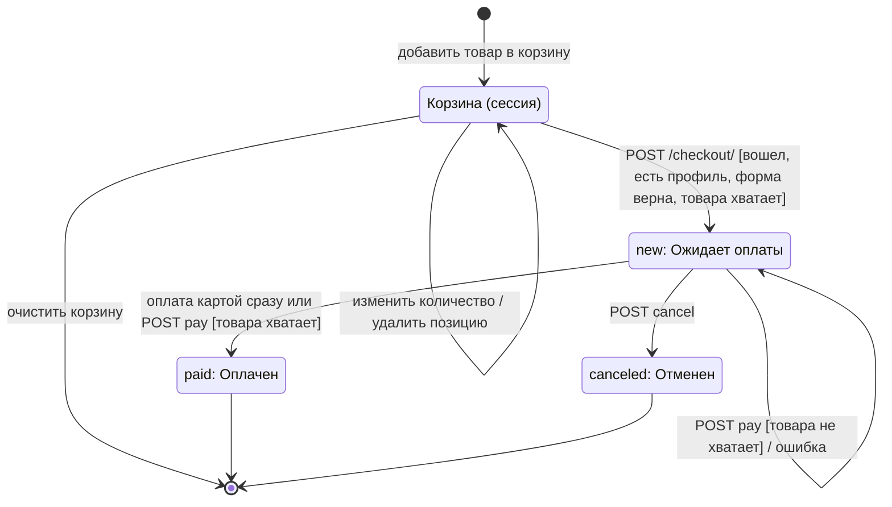

# Диаграмма состояний: Заказ (`Order`)

Сущность с жизненным циклом — **заказ**. Поле `Order.status`: `new` (Ожидает оплаты), `paid` (Оплачен), `canceled` (Отменен).
Переходы реализованы методами `Order.pay()` и `Order.cancel()` в `shop/models.py`.

| Из | В | Событие | Условие (guard) | Действие |
| --- | --- | --- | --- | --- |
| — (начало) | Корзина | `POST /cart/add/<id>/` | товар активен, остаток > 0 | позиция в сессии |
| Корзина | `new` | `POST /checkout/` | вошел, профиль клиента, форма верна, хватает товара | создаются `Order` и `OrderItem`, корзина очищается |
| `new` | `paid` | способ оплаты «карта» (сразу) или `POST /orders/<id>/pay/` | статус `new`, хватает товара по всем позициям | `Sale` по каждой позиции, остаток уменьшается, `paid_at = now` |
| `new` | `new` | `POST /orders/<id>/pay/` | товара не хватает | сообщение об ошибке, ничего не меняется |
| `new` | `canceled` | `POST /orders/<id>/cancel/` | статус `new`, владелец заказа | статус `canceled` |
| `paid` / `canceled` | — | `pay` / `cancel` | — | запрещено: `ValidationError`, сообщение об ошибке |

**Начальное состояние** — корзина (заказа в БД еще нет); первое состояние в БД — `new`.
**Конечные состояния** — `paid` и `canceled`.

Переходы проверяются тестами `shop/tests/test_scenarios.py` и `shop/tests/test_unit.py` (`test_cancel_*`, `test_pay_*`).
